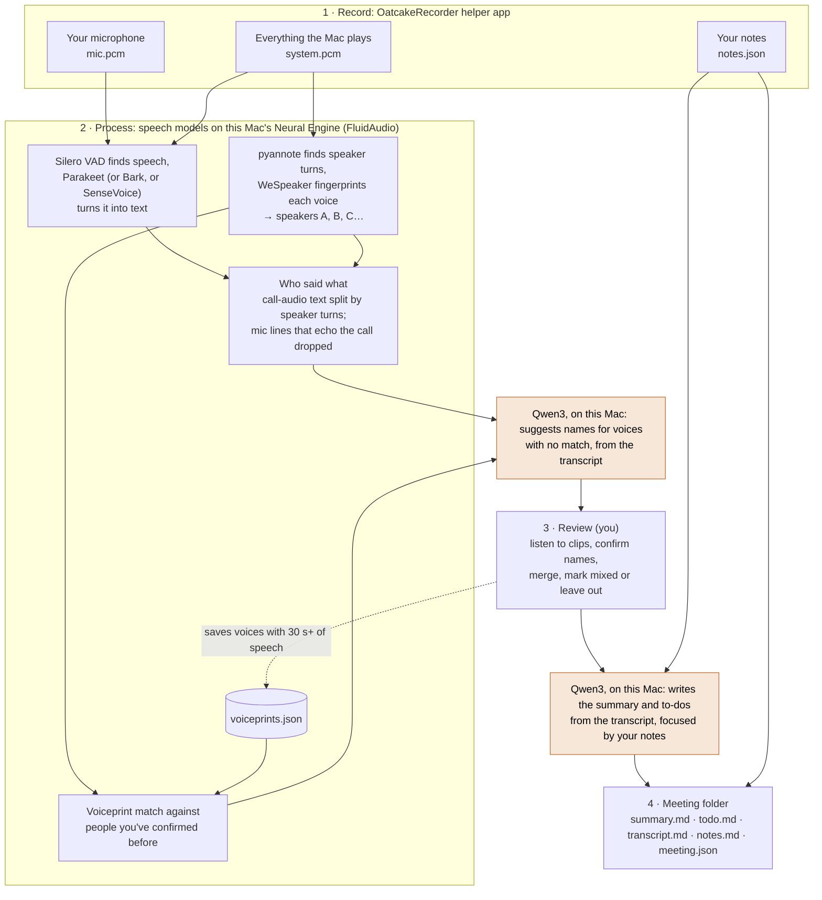

# How it works

Everything runs on this Mac, and nothing from a call is sent anywhere. Silero, Parakeet (or the
Bark or SenseVoice you choose instead), pyannote and WeSpeaker are small speech models (Parakeet
is 0.6B parameters), run on the Neural Engine
through [FluidAudio](https://github.com/FluidInference/FluidAudio)'s Core ML builds: they turn
audio into text and voices into fingerprints, take no prompts, and can't write anything else. The
two orange steps are the only language model: Qwen3, which Oatcake downloads once and runs itself
with [llama.cpp](https://github.com/ggml-org/llama.cpp) (see [Language model](models.md#language-model)). It only ever sees
text (the transcript and your notes), never audio. You can point Oatcake at a model server of
your own, on your Mac or your network, instead.

## The window

Oatcake opens on **Home**, or on a recording that was still going when it was last closed. Home
shows upcoming calls, the ten most recent saved meetings across all folders, and a button to start
a new recording or return to the one in progress. Click a recent meeting to open it, or **View all
meetings** to open the library. When to-dos are enabled, Home also shows up to five open items,
earliest due first, with their assignees and due dates. Add or tick off to-dos on Home, or choose
**View all to-dos** to manage the full list.

When browsing meetings, the window has three columns: the sidebar, the meetings in the selected
folder, and the meeting itself. The house icon next to Settings returns to Home. The sidebar has
a recording in progress, To-dos, Upcoming, Needs review, folders, and any meetings at the top
level. The same sidebar is available on Home. A one-off call with no
folder of its own is saved at the top level; drag it onto a folder to file it. Clicking the
Meetings heading lists every meeting, and an empty folder offers **Record here**. Drag the divider
to resize the meeting list; it keeps that width when you switch screens. Settings (⌘,) is
its own window, in panes; changes apply as you make them (see [Settings](settings.md)).

⌘N starts a new recording, ⌥⌘F searches every meeting from the box above the meeting list (its
title, folder, summary, to-dos, notes and transcript; a meeting found by its text shows the line
with the words and opens there), and ⌘F finds words in the transcript you're reading. ⇧⌘N makes a
folder and ⌘R refreshes the calendar; all of these are in the File and Edit menus. View › Bigger
Text (⌘+), Smaller Text (⌘-) and Actual Size (⌘0) change the size of what you read and type:
summaries, transcripts, notes and answers.

By default, closing the window keeps Oatcake running in the background, checking for calls and
sending reminders. It stops appearing as a running app in the Dock and stays in the menu bar.
Choose **Open Oatcake** there to bring back the window and Dock icon. Turn off **Run in the background** in Settings › General to quit when the last window
closes, once any recording or work has finished. **Quit Oatcake** (⌘Q) stops Oatcake and its call
checks regardless of this setting.

## 1. Record

New recording, or click an event under Upcoming. Pick the folder (a calendar event picks the
folder named like it, or the one its earlier meetings are in, or offers a new one for a recurring
event); leave the title blank to use the folder's name. The screen shows the event's attendees
and its **Join the call** button, the open to-dos from the latest earlier meeting in that folder
that has any (ticking one updates its `todo.md`), and takes prep notes, which open the call's
notes: type them one at a time or paste a list, which becomes a note per line. They're kept for
that call until it's recorded (for up to 30 days), so you can write them ahead and come back.

If you've set up [summary templates](settings.md#summaries), choose one on **New recording**.
For a calendar event, Oatcake suggests the template from the latest saved meeting with the same
title, or **Default** if there isn't a matching template. You can change the choice for this
recording. Oatcake keeps it with the saved meeting and uses it for the first summary, whether
that's written automatically or later. Selecting a template doesn't turn on automatic summaries.

Your microphone is recorded as you; everything the Mac plays (Zoom, Meet, Slack, anything) is
recorded as the other people. During the call, write one point per line: each is stamped with the
time you started typing it, and every line stays editable. The recorder is a small helper app
(`Sources/OatcakeRecorder`) inside Oatcake; macOS asks for microphone and system-audio permission
in Oatcake's name, once; if it hasn't started after a few seconds, the live screen says to look
for that prompt. Until the recorder has sent any audio, **Cancel** throws the recording away (and
**Close** does, if it never starts); either asks first if you've typed notes.

Pick the microphone on the record screen, from the mic button during the call, or in Settings ›
General: "Same as Mac" follows System Settings › Sound; a chosen mic is used until it's unplugged,
then the Mac's input until it's back. Changing mic mid-call carries on recording, with the switch
filled with silence so your track stays lined up with the call.

You're warned after 30 seconds of a silent mic or no call audio, on the call's screen and with a
notification, since you're probably looking at the call (the no-call-audio notification only
while a calling app has the microphone: dictating on your own, there's no call audio to miss). The
silent-mic notification comes once a recording, and once more if you change microphone (a headset
that cuts out room noise is silent whenever you aren't talking); the call's screen goes on saying
so for as long as the mic is silent. If the recorder stops or never starts (no permission, a full
disk), Oatcake notices (within a couple of seconds once it stops, or after 15 seconds of not
starting), says so the same two ways, and keeps and processes whatever was recorded. Stop asks
first, and so does quitting Oatcake while a call is being recorded, analysed or summarised, or
meetings are being imported.

### Live transcript

Beside your notes, **Transcript** shows the call as it's said, a moment after each pause (a second
helper, `Oatcake --live`, transcribes the audio as the recorder writes it). Your lines are yours.
Each line from the call side gets a fingerprint, and the name of whoever it sounds like: someone
Oatcake knows by voice, or someone you've named on another line. A line nobody can be sure of gets
an obviously made-up name, a different one every time ("Mystery Guest", "Captain Placeholder"…).

Click a line's name to say who said it: the menu lists the people Oatcake knows by voice and the
people on the calendar invite. Oatcake follows that voice for the rest of the call, and fills in
the earlier lines that sound like it too. Naming a line someone else when Oatcake had put a known
person's name on it puts that person's saved voiceprint aside for this call. **Take back** undoes a
name you gave. The names you give are kept in the recording (`live-names.json`), and Who's who
starts from them after the call (see [Review](#3-review-whos-who)).

One line gives a rougher fingerprint than a whole call, and can hold two people, so the live names
are for following the call; the voices are told apart properly once it's over. Matching uses the same rule
as review (see [Accuracy](models.md#accuracy)). Settings › General turns the live transcript off,
or only the naming of voices, which saves about 180 MB of memory during a call.

### Calls are noticed

When a calling app or a browser starts using your microphone and nothing is being recorded, a
notification offers **Start recording** (under the calendar event happening now, if there is
one). When a recording has had a calling app on the microphone, and that app has let go and the
call audio has been quiet for 15 seconds, a notification says the call seems to have ended; 30
seconds later the recording stops and starts processing, unless you choose **Keep recording** (on
the notification or the call's screen) or the call comes back. Music still playing, or a call
you're only muted on, keeps it going. Oatcake tells which apps have a microphone open from Core
Audio (`Sources/OatcakeCore/CallDetector.swift`); it doesn't listen until you record. Both are
switches in Settings › General.

### The menu bar

While a call is being recorded the menu bar shows its running time, with **Stop Recording…**
(which asks first) in its menu. When not recording, the Oatcake icon is there if **Run in the
background** is on or calendar details are shown. **Show my next call in the menu bar** in Settings
› Calendar adds the time until your next call and lists up to six calls today and tomorrow (click
one to open its New recording screen). The menu offers **Open Oatcake** and **Quit Oatcake**,
and **New Recording…** when not recording.
The menu bar item is drawn by a third helper, `Oatcake
--menu-bar`, a menu-bar-only app: macOS doesn't show a Dock app's menu bar menu while another app
is in full screen.

A recording started from a calendar event keeps the event's **Join the call** button on its
screen, for when you press record before joining.

## 2. Process

On this Mac, in the background. The speech model (Parakeet unless you've chosen another)
transcribes both tracks. The call audio is split into
voices by FluidAudio's batch diariser (pyannote segmentation, WeSpeaker fingerprints, VBx
clustering). It runs as a helper process (`Oatcake --analyse`), so a problem there can't take the
window or a recording in progress with it. Mic lines that repeat the call audio (speaker echo) are
dropped. Voices you named in the live transcript get those names (a voice takes the name given to
the lines it said most of); known voices are recognised from saved voiceprints; other names are
suggested from the conversation by the summary model, quoting the words that gave it away (not when
After a call is set to save the transcript only: see
[Saving without Who's who](#saving-without-whos-who)). The recording waits under
Needs review with its step (1–5), and the Dock icon's badge counts the recordings waiting there. A
failure shows the reason, with **Try again** and **Discard…**; **Discard…** is in the toolbar while
it's processing and on Who's who as well.

## 3. Review (Who's who)

Change the title or the folder it's saved in if you want to. One card per voice: play its clips,
confirm or type the name, or pick one of the people on the call's calendar invite (each is offered
until they've been given a voice) (with where the suggestion came from: named by you during the
call, recognised from before, or guessed from the conversation), merge it into another
voice or into you, mark it as mixed ("Several people"), or leave it out when it isn't part of the
call (people talking in the background, say): its lines then stay out of the transcript, the
summary and the to-dos. **Put back** undoes leaving one out, and **Undo** a merge. Unnamed voices
are saved as "Voice 1", "Voice 2"… The transcript beside it updates as you name voices. Confirmed
voices with 30+ seconds of speech are saved, so they're recognised next time.

### Saving without Who's who

Settings › General › **After a call** can save each call as soon as it's processed, instead of
waiting here: **Save with a summary**, or **Save the transcript only** (no summary or to-dos).
Voices you named during the call, and voices Oatcake is sure it recognises from before, keep their
names (a closer match than this screen asks for, since nobody is looking), and every other voice is "Voice 1", "Voice 2"…, whatever the
model guessed from the conversation: a guess, or a match that wasn't sure enough, waits on the
voice's card as a suggestion. **Save the transcript only** doesn't ask the model for names at all, so
the call is saved as soon as it's processed and only a match that wasn't sure enough waits as a
suggestion. No voice is remembered from names nobody checked.

The meeting says it was saved without checking who's who: **Name voices…** opens this screen for
it, and **Update meeting** writes its transcript and `meeting.json` again in place, puts the new
names where the old ones were in its summary and to-dos (as whole words: each "Voice N" stands for
one voice, so it's an exact swap wherever the model wrote it that way), and leaves your notes and
its title as they are. Name them while the summary is still being written and it's written again
from the named transcript. **Keep as is** keeps the names it has. If a call can't be saved by
itself, it waits here as usual.

## 4. Save

The meeting is a folder in the folder you picked: `2026-11-05 1400 Weekly sync/` with
`summary.md`, `todo.md` (action items, as `- [ ] Task — Owner — due Fri, Oct 30 — [12:34]`),
`transcript.md`, `notes.md` (your own notes, untouched; prep notes have no time) and
`meeting.json` (title, times, participants), plus `draft.md` once you've written a
[draft for sharing](#draft-for-sharing). A long turn in the transcript is broken at a pause
about every half minute, each part with its own time.

Saving doesn't involve the summary model: the meeting is written straight away with its transcript
and notes, and its summary and to-dos are written in the background and appear in the meeting when
they're ready. Your notes steer what the summary focuses on but aren't copied into it. If the
summary can't be written (the model's download was interrupted, a server of your own that's down),
the meeting says why in plain words (the raw message is behind Details) and shows **Write summary**
to try again later.

Summaries, to-dos, drafts for sharing and Ask's answers call everyone they/them. The model only
has a name to go on, and guessed wrong: a man with a name it read as a woman's was "she", and
telling it his pronouns still left "she" in about 1 summary in 4. So every he/him/his and
she/her/hers it writes is changed to they/them/their afterwards, with the verb after it agreeing
("she needs" becomes "they need"). That's done for English only; in another language "he" or
"her" can be another word.

### Reading and editing

Tabs: Summary (with the meeting's to-dos at the top), Transcript and My notes (⌘1–⌘3), and Draft
for Sharing (⌘4) in a meeting that has [one](#draft-for-sharing), each
Rendered or as editable Markdown from the switch at the top right of the note (saved as you type;
Summary shows `todo.md` and `summary.md`). **Copy** puts the tab you're on (the summary with its
to-dos, the transcript, or your notes) on the clipboard under the meeting's title and date,
formatted for Google Docs, Pages or mail and as Markdown for anything that only takes plain text,
and **Share** sends the same text with Mail, Messages or another app.

### Regenerate and summary templates

To write a summary or its to-dos again (after changing the instructions in Settings › Summaries,
say), choose **Regenerate › Regenerate summary** or **Regenerate to-dos** in the Summary tab's
toolbar and confirm. With [summary templates](settings.md#summaries) set up, Regenerate summary
lists them: the meeting's summary is written with the one you pick, and the meeting keeps it for
any summary written of it later. Only that part is asked for and replaced, edits and ticks
included; the rest of the meeting stays as it is. The old one stays until the new one is ready,
and stays if it fails or is changed somewhere else meanwhile.

### Draft for sharing

**Draft for Sharing…** in the Summary tab's toolbar has the model write the meeting's summary and
to-dos again for other people to read, following your
[draft for sharing instructions](settings.md#summaries), plus anything you ask for that draft alone
("shorter, and leave out the budget"). It's given the summary and to-dos as they are, with your
edits, and nothing else: not the transcript and not your notes, so it can't bring back anything
you took out of the summary. The draft goes in the meeting's `draft.md` and opens in a **Draft for
Sharing** tab (⌘4), which only meetings with a draft have; edit it there, then **Copy** or
**Share** it. Asking again replaces the draft, edits included, and says so first; the old draft
stays until the new one is ready, and stays if it fails or is edited meanwhile. Renaming speakers
renames them in the draft too.

### To-dos

Tick to-dos off in place; a due date can be a date ("Fri, Oct 30") or a day as it was said
("Friday", "tomorrow", "end of the week"), counted from the day of the meeting; a to-do's time
jumps to that moment in the transcript. **To-dos** at the top of the sidebar gathers every
meeting's to-dos (open and overdue counts beside it): Open / Done / All, grouped by due date,
folder or owner, filtered by owner ("Mine" is your name from Settings). Ticking one there updates
that meeting's `todo.md`, and under Open it leaves the list (it's under Done if you didn't mean
it). Add a to-do under a meeting's Summary and it goes in that meeting's `todo.md`; add one on the
To-dos page and it goes in the Meetings folder's own `todo.md`, owned by you unless you name
someone. Type owner and due date after dashes: `Send the deck - Jane - due Fri, Nov 6`. If you keep
your tasks somewhere else, turn off [Collect to-dos](settings.md#general) in Settings › General.

### Organising meetings

Organise meetings by dragging them onto folders; ⌘-click or ⇧-click selects several, and they all
move. Right-click a meeting for **Rename…**, **Show in Finder** or **Move to Trash**, or several for
**Show in Finder** or **Move to Trash** (⌘⌫ in the File menu does the same); **Show in Finder** is in the meeting's toolbar too. Renaming
a meeting changes its title (in `meeting.json`) and its folder's name, which keeps its date.
Folders can hold folders: right-click one for **New Folder Inside…**, **Rename…**, **Show in
Finder** or **Move to Trash** (which asks first if it holds meetings). Finder and the app stay in
step. The middle column's width drags, like the sidebar's.

### Rename Speakers

**Rename Speakers** in a meeting's toolbar puts a wrong name right after the meeting is saved, or
names a "Voice 2": it lists the transcript's speakers, each with their first words, and a field for
another name. Only that meeting changes: the transcript's labels (never what was said), the names
in its summary and to-dos, and its people in `meeting.json`. Two names can swap, and giving two
speakers one name makes them one; "Several people" stays as it is. The fingerprint saved from that
call goes with the name, so the next call isn't recognised as the wrong person too. It stays only
when the new name is the old one spelt out ("John" → "John Smith") and the voice clearly matches
their other calls (Settings › People renames a person everywhere). A meeting saved without checking
who's who has **Name voices…** instead.

## 5. Ask

The lozenge at the bottom of a meeting takes questions about it ("what did we decide about
hiring?") or across meetings ("when did Jane first raise the launch date?"); an empty chat offers
three to start with. The model on your Mac is given the meeting you have open: its summary,
to-dos, your notes and the transcript (all of it, or for a call too long for that, the parts
nearest the question). It's first asked whether the question reaches beyond that meeting. When it
does, Oatcake searches your other meetings for the names and topics the model gives, favours the
other meetings in the same folder, and adds their summaries, to-dos and the transcript lines that
match. The model never opens a file or runs anything itself. Answers link to the meetings they
draw on, and a time in an answer opens the transcript at that moment. An answer is one piece of
text: select any stretch of it, or all of it, and copy. Web links in an answer are shown as text,
not made clickable. Follow-ups continue the same conversation, which stays open as you move
between meetings, until **New chat**. **Stop** ends an answer early, and Esc or **Hide** puts the
chat away. The first question about a call takes longest, while the model reads it; follow-ups
about the same call are quicker.
